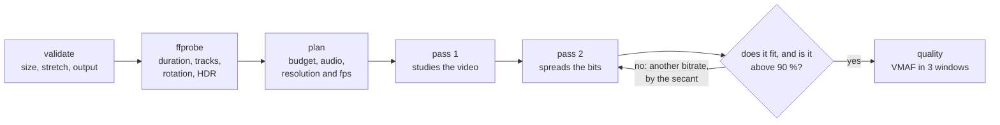

<p align="right"><sub><b>English</b> · <a href="README.md">Español</a></sub></p>

# vidsquash

<p>
  
  
  
  
  <a href="LICENSE"></a>
</p>

Squeeze a video so it fits a size: Discord's 10 MB, WhatsApp's 16, an email's 25. vidsquash doesn't ask you for a bitrate or a quality: you tell it what size it has to reach and it decides the rest (resolution, frames per second, audio, how many bits go to each thing) so it looks as good as possible and never goes over.

```powershell
vidsquash partida.mp4 --for discord                    # 10 MB
vidsquash viaje.mov -s 16MB                            # for WhatsApp
vidsquash charla.mp4 -s 25MB --from 2:10 --to 5:40     # just one stretch
vidsquash juego.mp4 -s 50MB --keep-fps -p slow         # keep the 60 fps and squeeze out quality
```

> [!WARNING]
> **0.1.0, in progress: it hasn't been tested end to end with real videos yet.** It builds, the interface is complete, the planner has its tests and the CI checks every validation of the `.exe`, but it has never encoded a real video: not a synthetic clip, not a vertical phone video, not an iPhone HDR one. Take it as a version to try out, not one to trust with the only original of a video. The plan for that test, and what to look at in it, is in [docs/PENDIENTE.en.md](docs/PENDIENTE.en.md). Until it passes there's no release and no demo.

A single pure-Go `.exe` that uses [ffmpeg](https://ffmpeg.org) to encode: no installer, no cloud; the video never leaves the machine. It used to live in navaja, a suite of console tools for Windows, with the engine written and no executable; as a project of its own it starts at 0.1.0, with its entry point.

[Status](#status) · [Why](#why) · [Install](#install) · [Usage](#usage) · [How it works](#how-it-works) · [How it was verified](#how-it-was-verified) · [What's missing](#whats-missing)

## Status

| | |
|---|---|
| **Checked** | that it builds and passes `go vet` (for Linux too); **57 Go tests**, 7 of them for the planner; the help, the version and every command-line validation of the `.exe`, with its message and its exit code, on every CI run; that it finds ffmpeg where `winget` leaves it |
| **Written, not tested against a video** | reading the video with ffprobe (rotation, HDR, audio), the two passes with size correction, the HDR → SDR conversion, quality measurement with VMAF |
| **Designed, not written** | `--analyze`: picking resolution and fps by measuring samples instead of estimating |

## Why

Shrinking a video to send it is a budget problem, not a quality one: the limit is in megabytes. The usual recipes ask for a CRF or a bitrate and you keep trying until it fits; with a fixed bitrate, the size depends on the duration, and the same number that leaves a 30-second clip at 5 MB leaves a 3-minute one at 30. And there are decisions the number alone doesn't make:

- **With few bits, fewer frames or less resolution.** On a tight budget, a 1080p60 usually looks worse than a 720p30: there aren't enough bits per pixel.
- **The audio counts too**, and a clean mono sounds better than a squeezed stereo.
- **A vertical phone video** isn't one that's 1920 tall: the resolution ladder goes by the short side.
- **An iPhone HDR video** looks washed out on a regular screen if it isn't converted to SDR.
- **"Almost 10 MB" doesn't fit in Discord.** The result has to come in under, always.

## Install

vidsquash uses **ffmpeg** to encode:

```powershell
winget install Gyan.FFmpeg
```

It looks for it next to `vidsquash.exe`, then on the `PATH` and then where winget leaves it: in `WinGet\Links` or in the Gyan.FFmpeg package under `WinGet\Packages`. That way it also finds it in a terminal opened before installing it, which doesn't see the new `PATH` yet.

With [Go](https://go.dev/dl) 1.26 or newer (with an older Go 1.21+, Go downloads the version the `go.mod` asks for on its own):

```powershell
go install github.com/agustinyarrus/vidsquash@latest
```

From the repo:

```powershell
.\build.ps1          # dist\vidsquash.exe, with the version, the commit and the SHA256
.\build.ps1 -Test    # before that, go vet and all the tests
```

There's no release yet: the first one, 1.0.0, comes out when the test with real videos passes. It has no external Go modules.

## Usage

| Flag | What it does |
|---|---|
| `-s`, `--size SIZE` | the maximum size of the final file: `25MB`, `8M`, `1,5GB`, `500KiB` |
| `--for discord\|whatsapp\|outlook\|gmail` | a service's limit: 10, 16, 20 or 25 MB |
| `--from TIME`, `--to TIME` | just one stretch (`90`, `1:30`, `1m30s`) |
| `-c`, `--codec h264\|h265` | h264 plays everywhere; h265 takes ~30 % less space but not everything opens it (h264) |
| `-p`, `--preset veryfast…slower` | the encoder's effort: slower, better quality at the same size (medium) |
| `--max-res N` | cap on the short side (720 = at most 720p) |
| `--keep-fps` | don't lower the frames per second (games, sports) |
| `--no-audio` | drop the audio: every bit goes to the video |
| `-o`, `--out FILE` | the output (by default, `<name>-<size>.mp4` next to the original) |
| `-f`, `--force` | overwrite the output if it already exists |
| `--no-quality` | don't measure the quality at the end |

Sizes are in decimal units (1 MB = 1,000,000 bytes), the way the services advertise them; `MiB` and `GiB` are accepted too, and so is the decimal comma. GNU-style flags; a misspelled flag or value suggests the closest one. Exit codes: `0` all good · `2` invalid command line · `3` it couldn't be done (the file doesn't exist, the size is missing, there's no ffmpeg, the target isn't reachable) · `130` canceled with Ctrl+C.

<details>
<summary><code>vidsquash --help</code>, in full</summary>

```text
> vidsquash --help

  vidsquash  ·  comprime un video para que entre en un tamaño                               v0.1.0

  uso
    vidsquash <video> -s <tamaño> [opciones]
    vidsquash clip.mp4 -s 25MB
    vidsquash clip.mp4 --for discord

  objetivo
    -s, --size TAMAÑO                tamaño máximo del archivo final: 25MB, 8M, 1,5GB, 500KiB
        --for discord|whatsapp|outlook|gmail
                                     límite de un servicio: discord 10 MB · whatsapp 16 MB ·
                                     outlook 20 MB · gmail 25 MB

  recorte
        --from TIEMPO                empezar en este punto (90, 1:30, 1m30s)
        --to TIEMPO                  terminar en este punto

  receta
    -c, --codec h264|h265            h264 se reproduce en todos lados; h265 ocupa ~30 % menos pero
                                     no todos lo abren (h264)
    -p, --preset veryfast|faster|fast|medium|slow|slower
                                     esfuerzo del codificador: más lento = mejor calidad al mismo
                                     tamaño (medium)
        --max-res N                  tope del lado corto (720 = como mucho 720p) (0)
        --keep-fps                   no bajar los cuadros por segundo (juegos, deportes)
        --no-audio                   descartar el audio (todos los bits al video)

  salida
    -o, --out ARCHIVO                archivo de salida (por defecto: <nombre>-<tamaño>.mp4 al lado
                                     del original)
    -f, --force                      sobrescribir la salida si ya existe
        --no-quality                 no medir la calidad al final (ahorra unos segundos)

  general
    -h, --help                       muestra esta ayuda
    -V, --version                    muestra la versión
        --no-color                   salida sin colores (también respeta NO_COLOR)

  ejemplos
    vidsquash partida.mp4 --for discord                que entre en los 10 MB de Discord
    vidsquash viaje.mov -s 16MB                        para WhatsApp; un video HDR de iPhone se
                                                       convierte a SDR
    vidsquash charla.mp4 -s 25MB --from 2:10 --to 5:40
                                                       solo un tramo, para mandarlo por mail
    vidsquash juego.mp4 -s 50MB --keep-fps -p slow     conservar los 60 fps y exprimir calidad

  notas
    · Los tamaños van en unidades decimales (1 MB = 1.000.000 bytes), como los anuncian los
      servicios.
    · Codifica en dos pasadas y, si el resultado se pasa del límite, corrige solo la segunda:
      nunca entrega un archivo más grande que el pedido.
    · Con pocos bits, primero baja los cuadros por segundo (60 → 30) y después la resolución: en
      contenido común se ve mejor.
    · Necesita ffmpeg (winget install Gyan.FFmpeg). Todo es local: el video no sale de la máquina.
```

</details>

What you can already see of the `.exe` is the boundary: every validation happens before looking for ffmpeg, so a usage error doesn't wait for anything to start. Real outputs, in a 100-column console (the tool speaks Spanish):

```text
> vidsquash partida.mp4 --for discrod

  ✗ --for: "discrod" no es una opción; ¿quisiste decir "discord"? (discord, whatsapp, outlook,
    gmail)
  › vidsquash --help muestra todas las opciones
```

```text
> vidsquash partida.mp4 -s 50KB

  ✗ 50,0 KB es demasiado poco para un video
```

```text
> vidsquash partida.mp4

  ✗ falta el tamaño objetivo: -s 25MB o --for discord
```

## How it works

> This describes how it's written, not something that has already been checked with real videos.



### The plan

[`squash.MakePlan`](internal/squash/plan.go) is pure: it takes what ffprobe said and the options, and returns the recipe or why it can't be done, without touching the disk or launching anything. That's why it's the part that has tests.

- **Budget**: the target minus a 2 % margin, minus what the MP4 container takes (4,096 fixed bytes, 12 per video frame and 6 per AAC audio frame). What's left, divided by the duration (the stretch's, if there's a cut), is the kb/s.
- **Audio**, in steps (160, 128, 96, 64, 48 or 32 kb/s), never above the original, stereo at most and mono below 64 kb/s.
- **Resolution and frames per second**, by bits per pixel: the first combination that reaches 0.050 in H.264 (0.035 in H.265). The resolution ladder goes by the short side (2160, 1440, 1080, 720, 540, 480, 360, 240) and never upscales; at the same resolution the original fps is tried first and then half of it (if the original is above 30 and the half doesn't drop below 24).
- **Impossible targets**: below 45 kb/s of video it's no longer video, it's a mosaic. The plan returns an error with a suggestion (cut it or ask for more), not a file that's useless.

### The passes

- **Two passes**: the first one studies the whole video and notes where bits are needed; the second spreads the budget with that information.
- **Secant correction.** If the result goes over the target or stays below 90 %, only the second pass is repeated (the first pass's statistics work for any bitrate). The next bitrate comes from the secant method on size(bitrate), which is monotonic; it aims at 98.5 % of the target, the last correction at 97 %, and there are three at most.
- **Never bigger than requested**: it keeps the biggest attempt that fits, and if none fits it's an error.
- **HDR → SDR** with the Hable curve, going through linear light (`zscale`); the container with `+faststart`, so the video starts before it's fully downloaded, and the `hvc1` tag in H.265, without which iPhone and Mac won't play it.
- **No half-written files**: attempts go to a working folder of their own that's deleted at the end, and the best one is moved to the destination. A Ctrl+C stops ffmpeg and leaves nothing in the video's folder.

### The quality

VMAF, Netflix's perceptual metric (0 to 100), over three 2 s windows at 20, 50 and 80 % of the video, against the original brought to the same resolution and the same frames; if the installed ffmpeg doesn't ship libvmaf, SSIM. The card turns it into words ("indistinguishable from the original" from 93, "very good" from 85…).

More detail: [docs/ARQUITECTURA.en.md](docs/ARQUITECTURA.en.md).

## How it was verified

- **57 Go tests** (`go test ./...`). The 7 for the planner check, on described videos (without ffmpeg), that the plan never promises more bytes than the target, that vertical videos are scaled by the short side, that it never upscales, that with few bits the fps drops first, that an impossible target gives an error with a suggestion, and the audio rules. Another one checks that ffmpeg is found in winget's package.
- **The `.exe`'s boundary** ([`frontera.ps1`](.github/frontera.ps1)), on every CI run: the help, the version, a file that doesn't exist, a size that's missing or isn't reachable, `--to` before `--from`, a misspelled `--for` and flag and, with no ffmpeg in sight, that it says so. 9 out of 9, each with its message and its code.
- **CI on `windows-latest`** with the minimum Go from the `go.mod` ([`ci.yml`](.github/workflows/ci.yml)): formatting, `go vet` (for Linux too), all the tests, the `.exe` with its version and its SHA256, and the boundary.

What's missing is what matters: encoding real videos and checking with `ffprobe`, which is independent of vidsquash, that the size stays below the target and that the duration and the tracks are preserved. The details: [docs/VERIFICACION.en.md](docs/VERIFICACION.en.md).

## What's missing

1. **The end-to-end test** with a synthetic 1080p60 clip, a vertical phone video and a rotated iPhone HDR one, at 10, 16 and 25 MB and with a cut. What to look at there, because no test covers it: that the rotation is applied only once, a video with cover art, one with variable fps, the tone mapping with winget's ffmpeg and that the correction converges in one or two attempts. With that passed, 1.0.0 and its release.
2. `--analyze`: picking resolution and fps by measuring samples.
3. Minor ones: a missing size is a usage error and today it exits with code 3 (it should be 2); a fake ffprobe to test reading rotation and HDR without ffmpeg.

The list, with how to verify each point: [docs/PENDIENTE.en.md](docs/PENDIENTE.en.md).

## Structure

```
main.go               opens the console and calls vidsquash.Main
internal/
  vidsquash/          the tool: flags, presets, the recipe, the live progress and the card
  squash/             the planner (pure), the two passes with correction and the quality
  ffx/                finding and running ffmpeg and ffprobe, reading the video and the progress
  fsx/                atomic writes, display names
  cli/                GNU-style flags, sizes and times, help, "did you mean…?"
  tui/                console: palette, live region, cards, es-AR formatting
  textdist/           Damerau–Levenshtein distance
  win/desk/           console mode and size, through syscall
  version/            version and commit, stamped by build.ps1
docs/                 architecture, verification and what's missing
.github/              the CI: formatting, vet, tests, the .exe's boundary and its SHA256
build.ps1             builds dist\vidsquash.exe with the version and the commit (-Test: vet and tests first)
```

## License

[MIT](LICENSE).

<!-- i18n source=README.md sha256=efd1e59a9b3a -->
